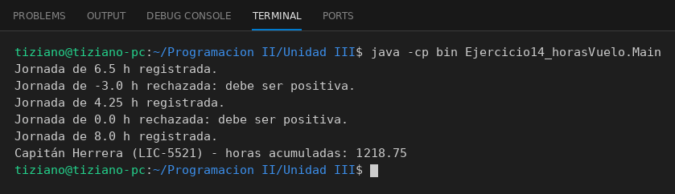

# Piloto

Programación II - Unidad 3 - Ejercicio 14

## Consigna
Modelar la clase aplicando encapsulamiento: atributos privados y métodos públicos que validan antes de modificar el estado. Las horas de vuelo de un piloto, que solo pueden incrementarse.

## Lógica
- Atributos privados: licencia, nombre y horas acumuladas.
- `registrarVuelo(horas)` suma solo valores positivos.
- Sin setter sobre el acumulador; solo `getHorasVuelo()`.
- `Main` registra jornadas válidas e inválidas.

## Ejecución

